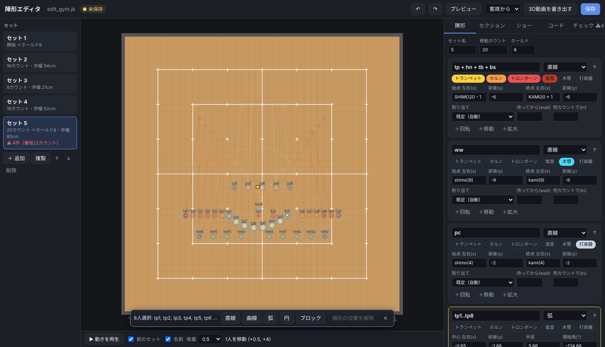

# 陣形 (Jinkei)

マーチングのドリル（隊形と移動）を設計するための言語とエンジン（Rust製・外部依存なし）。

一人ひとりの座標は打たない。**「この人たちはこの形」と図形で書く**と、エンジンが

- 全員の位置を計算し、
- **誰がどこへ行くかを自動で割り当て**（移動距離の合計が最小・経路が交差しない・他の人の動きを避ける）、
- **歩幅・衝突・場外**をカウント単位で厳密にチェックし、
- ヤードライン/ハッシュ基準の**ドットシート**と、**再生できるプレビュー**を出す。

```
show "体育館ドリル" {          # 会場を書かなければ体育館（30m×30m 演技フロア）
  tempo 120
  section tp "トランペット" 8
  section tb "トロンボーン" 8

  set 1 {
    tp + tb : line (SHIMO20, FRONT20) -> (KAMI20, FRONT20)   # 20mラインの前辺
  }
  set 2 counts 16 {
    tp + tb : circle (0, 0) radius 6
  }
  set 3 counts 8 {
    tp + tb : same rotate 30
  }
}
```

## GUIエディタ

```sh
cargo build --release
./target/release/jinkei edit myshow.jk     # ブラウザでエディタが開く（ファイルがなければひな形を作る）
```



- **フィールド上でドラッグ**: ■ は隊形の中心、● は直線の端・弧の端・円の半径・曲線の通過点。動かすとエンジンがすぐ計算し直し、自動割り当て・移動線・歩幅・衝突の警告が更新される。吸着は 0.25 / 0.5 / 1（`Shift` で吸着なし）。
- **左: セット一覧** — 追加（全員その場の新セット）・複製・並べ替え・削除。各セットの最大歩幅と警告数、「最低何カウント必要か」を表示。
- **右: 隊形** — セットごとの隊形カード。対象（セクションのチップをクリックで追加/除外）、形の種類、数値（`shimo(9)` や `FRONT20 + 2` のような式も可）、回転・移動・拡大、割り当て、wait / in。
- **右: セクション / ショー** — パートの記号・名前・人数・色、会場（体育館・ステージ・フットボール・フロア）、テンポ、警告の基準。記号を変えると隊形の対象も自動で書き換わる。
- **右: コード** — 同じ内容をコードで直接編集でき、画面と双方向に同期する。コメントは保持される。
- **右: チェック** — 全警告の一覧。クリックでそのセットへ移動。
- **人を直接動かす**: ドットをドラッグするとその人だけが動く（隊形のほかの人の位置は変わらない）。`Shift`/`Ctrl`+クリックで追加選択、何もない所をドラッグで範囲選択、`Ctrl+A` で全員、`Esc` で解除。選んだ人はまとめてドラッグ、矢印キーで微調整（`Shift` で4倍）。
- **選んだ人を並べ直す**: 2人以上選ぶと画面下にバーが出て、**直線・曲線・弧・円・ブロック**に並べ替えられる。今の位置の並び（向き・順番）に合わせて形を当てはめるので、あとは ■ ● のハンドルで整える。並べ直しで全員が移った古い隊形は自動で消える。
- 個別に動かした人は「隊形」タブの「個別に動かした人」に一覧され、数値で直したり ✕ で隊形の位置に戻したりできる（選んで「個別の位置を解除」でも可）。
- ドットをクリックするとその人のドット情報が下に出て、その人の位置を決めている隊形カードが選ばれる。「▶ 動きを再生」で前のセットからの動きを確認。
- `Ctrl+S` 保存（初回は元ファイルを `.bak` に残す）、`Ctrl+Z` / `Ctrl+Shift+Z` で元に戻す/やり直し。
- 「プレビュー」で2D/3Dプレビューを新しいタブに、「3D動画を書き出す」で `myshow.mp4` を書き出す（ffmpeg が必要）。

エディタは手元のパソコンで動くローカルサーバ（`127.0.0.1` のみ）と、ブラウザの画面でできている。編集内容はファイルに保存されるだけで、外部には送られない。

## ブラウザ版（インストール不要）

```sh
./target/release/jinkei web -o jinkei.html
```

HTML ファイル1つに、エディタ・エンジン（`web/engine.js` の JavaScript 移植）・プレビュー・3D が入る。ブラウザで開くだけで使える（Chrome 推奨）。

- 「開く」「新規」、またはファイルのドラッグ&ドロップで `.jk` を読み込む。保存は Chrome ならファイルに直接、他のブラウザはダウンロード。
- 編集内容はブラウザに自動保存される。
- プレビュー・3D表示・動画の保存（ブラウザで録画）もこの1ファイルで動く。
- エンジンが Rust 版と同じ結果になることは `node web/conformance.js` で照合している（例とテストケース60本、ランダム生成）。

## ビルドと使い方

```sh
cargo build --release
./target/release/jinkei build examples/gym.jk -o gym.html         # プレビュー（2D/3D）＋ドットシート
./target/release/jinkei check examples/opener.jk                  # チェック（問題があれば終了コード2）
./target/release/jinkei dots  examples/opener.jk -p tp            # ドットシート（tp セクション全員）
./target/release/jinkei json  examples/opener.jk                  # 全データをJSONで（他ツール連携用）
./target/release/jinkei video examples/gym.jk -o gym.mp4          # 3D動画（要 ffmpeg）
./target/release/jinkei still examples/stage.jk --at 30           # 3D静止画（30カウント目）
```

### 3D動画

`jinkei video show.jk [-o 出力.mp4] [--camera audience|top|orbit|low|diag] [--size 1280x720] [--fps 30] [--speed 1] [--layout single|reel] [--part 名前] [--hud] [--no-audio]`

- 音: part（楽譜）があれば、`jinkei audio` と同じ合成音（48kHz）を AAC で混ぜる（`--no-audio` で無音。`--speed` を変えたときは atempo で音程を保ったまま伸縮。part がなければ音声なし）
- カメラ: `diag`（会場の後ろ・下手寄りの高い位置から、隊形の外接範囲を追いかける斜め俯瞰）、`audience`（客席／体育館なら2階ギャラリー、ステージならホール2階席）、`top`（真上）、`orbit`（客席側を左右に回り込む）、`low`（客席最前列の目線）
- 人物は楽器ごとに描き分ける。セクションの表示名から自動で判定し、`section tu "低音" 4 instrument marching_tuba` のように明示もできる（エディタの「セクション」タブでも選べる）
  - 金管: trumpet / mellophone / marching_horn / horn / trombone / euphonium / marching_euphonium / tuba（縦持ち）/ marching_tuba（左肩に担ぐ）/ sousaphone（体に巻き付け）
  - 木管: piccolo / flute / oboe / bassoon / eb_clarinet / clarinet / alto_clarinet / bass_clarinet / soprano_sax / alto_sax / tenor_sax / baritone_sax
  - 打楽器: snare / tenors / bass_drum（セクション内の並び順に小→大の5サイズ）/ bass1〜bass5（サイズ固定）/ cymbals_mid / cymbals_high / glockenspiel / xylophone
  - その他: flag（カラーガード）/ none（楽器なし）
- 画面下にショー名、セット名、移動/ホールドのカウント、テンポを日本語で表示。ffmpeg の subtitles フィルタ（libass）で描き、ffmpeg になければ英語の HUD に切り替える。テンポどおりの長さで書き出す（`--speed 2` で倍速）
- **縦動画（リール）**: `--layout reel`（別名 `split`。既定は従来どおり単一画面）で 1080×1920（9:16）を上から 4 段に組む。①斜め俯瞰の3D（`diag`）②白い帯にパート名（太字・中央）と 1 線の打楽器譜（現在の 2 小節をページ送り、再生位置の線、手順は強い音を大文字・普通を小文字、アクセント `>` `^`、連桁・連符・休符・フラム・バズ）③客席側・目線の高さの3D（中央ライン上から隊形の横幅いっぱいに映す。カメラ名 `front`）④真上のグリッド（会場の座標。体育館・ステージ・フロアは 1m 格子・5m 太線、フットボールは 8 to 5 の 5 ヤード線 = 8 歩ごとの太線とハッシュ。中心を通る軸付き）に、隊員ごとに色つき番号ピンと進行・向きの矢印。楽譜とグリッドは外部ライブラリなしの自前ベクタ描画（Bravura の形に近い音符など。`src/reel.rs`）。表示するパートは人数が最も多いもの（`--part 名前` で指定）。日本語 HUD は既定でオフ（楽譜の帯に情報があるため）、`--hud` で下部に重ねる。`still --layout reel --at 30` で 1 枚だけも出せる
  - ピンの色 = 袖の色（`render::member_color`。イラストでは `section` に `color` があればその色、なければ隊員ごとのパレット。リアルでは制服の色）。番号は隊員 ID の末尾の数字（`sn3` なら 3）。パレットの色を出したいときは `section` の `color` を書かない
  - 3D を 2 枚ぶん描くので時間は約 2 倍（スネア 7 人・21 秒・1080×1920・30fps で 2 コアのとき約 4 分。コア数に比例して速くなる）
  - 動画のサイズは `--size` で変えられる（高さに対して 32% / 13.5% / 30% / 残りの割合）
- 外部ライブラリなしの自前レンダラ。CPU のコア数ぶん並列で描画し、ffmpeg（macOS は `brew install ffmpeg`）で MP4 にする

プレビューHTMLの「3D で見る」でもブラウザ上で3D表示でき（ドラッグで回転、ホイールで拡大）、「● 動画を保存」でテロップ付きの動画を保存できる（Chrome 推奨）。パートの音も録音に含める（WebAudio の出力を MediaStream に分けて混ぜる。「音」のチェックが入っているとき）。

**レイアウト: 縦分割**（3D 画面の下のメニュー、URL なら `#view=3d&layout=reel`）は、上のコマンド版と同じ 4 段の縦長 9:16 画面をブラウザで見せる。3D は 1 つの WebGL キャンバスに 2 つのカメラ（斜め俯瞰・客席側）で描き、楽譜は `jkStaff`（`src/staff.js`、`paged` オプションで 2 小節ずつのページ送り）、グリッドは `jkReel.drawGrid`（`src/reel.js`）で、再生・音と同期する。このとき「● 動画を保存」は同じ構図を 1080×1920 で録画する（楽譜は SVG を画像にして合成。音声つき。ブラウザの録画機能に依存するので、画質・速度の安定が欲しいときはコマンドの `jinkei video --layout reel` を使う）。楽譜の人数最多パートが初期表示で、サイドの「楽譜」のパート選択で変えられる。

プレビュー（HTML）: 再生/停止（Space）、セット送り（← →）、ドットをクリックでその人の全経路とドットシート、警告をクリックでその瞬間へジャンプ、全員分のドットシート印刷。URL末尾 `#t=40&p=tp1&labels=1` で時刻・人・名前表示を指定して開ける。

## 会場と座標

| 会場 | 単位 | 原点 | 使える名前 |
|---|---|---|---|
| `field gym`（**既定**）/ `field gym 28 x 20` | メートル | 演技フロアの中心（十字ラインの交点）。+x = 上手（客席から見て右）、+y = 奥 | `FRONT` `BACK` `KAMI` `SHIMO`（外周ライン）、`FRONT20` `BACK20` `KAMI20` `SHIMO20`（20mライン）、`MID`、`kami(3)` `shimo(3)` `mae(2)` `oku(2)` |
| `field stage` / `field stage 18 x 12 wings 5` | メートル | 舞台前端の中央。+x = 上手、+y = 奥 | `FRONT`（舞台前端）`BACK` `KAMI` `SHIMO` `MID` `KAMIWING` `SHIMOWING`（袖の中央）、`kami()` `shimo()` |
| `field football hs` / `college` / `nfl` | 8to5 の1歩（22.5インチ） | x=0 が50ydライン（+がサイド2＝客席から見て右）、y=0 がフロントサイドライン（+が奥） | `FSL` `FH` `BH` `BSL` `MID`、`s1(35)` `s2(40)`（ヤードラインのx）、`yd(2)`（2ヤード分の歩数）、`m(3)`（3m分の歩数） |
| `field floor 24 x 18` | メートル | x=0 がフロア中央、y=0 が客席側の端 | `FRONT` `BACK` `LEFT` `RIGHT` `MID`、`m()` |

- 体育館の既定は 30m×30m の演技フロアで、20m×20m ライン・中心の十字ライン・5m ごとのポイントを描く（全日本マーチングコンテストの県大会要項にあるフロア表示に合わせた）。外周ラインを越えても警告せず、壁際（外周から約4.5m）を越えたら場外とする。
- ステージの既定（間口16m・奥行10m・袖4m）は仮の値。会場に合わせて `field stage 間口 x 奥行 wings 袖幅` で変更する。袖は立ち位置として使える（スタンバイ・入退場）。舞台前端より前に出ると「場外（転落）」として警告する。

点は `(x, y)`。中では `+ - * /` が使える（例: `(s1(35) - 2, FH + 4)`）。

## 隊形（図形）

人数は図形が自動で等間隔に割る。

| 書き方 | 意味 |
|---|---|
| `line (A) -> (B)` | 直線（両端を含む） |
| `arc (中心) radius r from 角度1 to 角度2` | 弧。0°=右(サイド2)、90°=奥、反時計回り |
| `circle (中心) radius r [start 角度]` | 円 |
| `block (中心) cols 列数 [spacing 間隔] [rows 前後間隔]` | ブロック。前列左から詰める |
| `curve (P1) -> (P2) -> (P3) ...` | 通過点をなめらかに結ぶ曲線上に等間隔 |
| `poly (P1) -> (P2) -> ...` | 折れ線上に等間隔（V字・ウェッジなど） |
| `at (P)` | 1人を1点に |
| `same` | 前のセットの位置のまま（変形と組み合わせる） |
| `follow (P1) -> (P2) -> ... [spacing 間隔]` | フォロー・ザ・リーダー。経路の始点に近い人が先頭になり、後ろの人は先頭が通った道をたどる（等間隔・同じ速さ）。到着後は経路の末尾に間隔どおり並ぶ。`assign keep` なら書いた順が先頭から。最初のセットでは使えない。 |

後ろに続けて書けるもの:

| | |
|---|---|
| `rotate 角度 [about (P)]` | 回転（既定は図形の中心まわり） |
| `shift (dx, dy)` | 平行移動 |
| `scale 倍率` | 拡大縮小 |
| `assign auto` / `assign keep` | 割り当て。既定は auto（`same` は keep）。keep は書いた順番どおり |
| `wait N` | N カウント待ってから動き出す（時間差） |
| `in N` | N カウントで移動を終える（早く着いて待つ） |
| `bend 角度` | **曲がって進む**。円弧の経路で、正 = 進行方向の左側にふくらむ、負 = 右側（-179〜179） |
| `face 向き` | **体の向き**。`front`（客席）`back`（奥）`kami`（上手）`shimo`（下手）`center`（隊形の中心へ）`out`（外へ）`travel`（進行方向）`toward (x, y)`（その点の方へ）、数値なら客席向きを 0° として上手側へ何度。日本語（客席・奥・上手・下手・中心・外・進行方向）でも書ける。書かなければ「移動中は進行方向、止まると客席向き」 |
| `step 種類` | ステップ: `glide`（グライド）`back`（バックマーチ：進行方向に背を向ける）`slide`（スライド：客席を向いたまま進む）`jazz`（ジャズラン）`high`（ハイステップ）。日本語（グライド・バック・スライド・ジャズ・ハイ）でも書ける。3Dで脚の動きが変わり、ドットシートに記載。 |
| `action 動作` | 手具・動作: `spin` `toss` `swing` `rest`（スピン・トス・スイング・レスト）。カラーガードの旗が3Dで動く。ドットシートに記載。 |

メンバーの指定: セクション名 `tp`、1人 `tp3`、範囲 `tp1..tp4`、組み合わせ `tp + mel + tb`、全員 `all`。セットで触れなかった人はその場に留まる。

**後に書いた指定が優先**: 同じセットで同じ人をもう一度指定すると、後の指定がその人だけを上書きする。前の隊形のほかの人の位置・間隔は変わらない（その人がいた場所が空く）。

```
set 5 counts 16 {
  tp + tb : arc (0, 0) radius 8 from 200 to 340
  tp3     : at (2, -6)                 # tp3 だけ前に出す
  tb1..tb3 : line (-9, 4) -> (-5, 4)   # tb1〜tb3 だけ別の線に
}
```

## 楽譜（part）— 演奏するパートを書く

`show` の中に `part` ブロックを書くと、そのメンバーが譜面どおりに演奏する（スネアなら叩く）。再生すると音が鳴り、エディタの「楽譜」タブでは五線（1線の打楽器譜）で確認できる。

```
part "スネアソロ" for sn {      # for のあとは隊形の対象と同じ書き方（セクション・メンバー・a + b・all）
  meter 4/4                      # 拍子（既定 4/4）
  start 8                        # 開始カウント（既定 0）。`start set 2` はセット2の頭から
  16: R r l r R r l r ^R r l r R l r l |
  repeat 2 { 8: R L R L R L R L | }
}
```

別名: `パート` `拍子` `開始` `くり返し`。コメントは `#` か `//`。

| 書き方 | 意味 |
|---|---|
| `R` `L` `B` | 右手・左手・両手。大文字 = アクセント付き |
| `r` `l` `b` | 同じく普通の強さ |
| `>R` / `^r` | `>` アクセント（大文字と同じ）、`^` 強いアクセント（マルカート） |
| `xR` `fR` `dR` `zR` | `x` スティック打ち（リム）、`f` フラム、`d` ダブル（2打を1音符で）、`z` バズ |
| `R2` `l5` | 手の直後の数字 = 打面・ドラム番号（下の表）。無指定 = 0 |
| `-` | 休符（今の音価ぶん） |
| `~` | タイ（直前の音符を今の音価ぶん延ばす） |
| `16:` `8:` `4:` `32:` | 音価の指定。以降の音符・休符に効く（既定 16）。`8.:` は付点 |
| `3[ r l r ]` | 連符。N個を「N より小さい最大の2のべき」個ぶんの時間に入れる（3連 = 2個ぶん、5連・6連・7連 = 4個ぶん） |
| `\|` | 小節線。長さが拍子と合わないと警告（エラーにはしない） |
| `repeat 2 { ... }` | くり返し |

時間の単位は「カウント」。拍子の分母の音符1つ = 1カウント（4/4 なら4分音符 = 1カウント、6/8 なら8分音符 = 1カウント）。休符は音符を作らず時間だけ進む。パートがショーの最後のセットより長ければ、最後のセットのホールドを延ばして全体の長さを合わせる。

打面（手の後ろの数字）:

| 楽器 | 番号 |
|---|---|
| スネア | 1 = センター（既定） 2 = リムショット 3 = スティック |
| テナー | 1〜5 = 低→高のドラム、6 = スポック（0 = 音符ごとに順に回す） |
| バスドラム | 1 = 最小 … 5 = 最大。その番号の人だけが鳴らす（0 = 全員で同時）。人の番号は `bass1`〜`bass5`、`bass_drum` ならセクション内の順（小→大） |
| シンバル | 1 = クラッシュ（既定） 2 = ハイハット閉 3 = ハイハット開 4 = チョーク |

打楽器は音符どおりに動く（3D のブラウザ表示も動画も同じ式: `src/strike.js` / `src/strike.rs`）。スネアはアクセントでスティックの高さが変わり、次の音符の高さに合わせて振りかぶり、音符のカウントちょうどで打つ。`x` はリム、`f` は逆の手のグレース、`d` は2回のバウンド、`z` は低く細かい震え。テナーは打面の番号で横に動き（番号なしは交互）、バスは右手が右、左手が左のヘッドを打ち、番号を付けるとその大きさのドラムだけが鳴る。シンバルはクラッシュ・ハイハット・チョーク、マレットは小節ごとに手の位置が変わる。1カウント以上音符がなければ構えに戻る。

JSON では `parts: [{name, members, meter, start, end, bars, notes: [[t, dur, "R", accent, "tap", pad], ...]}]`（t は通算カウント、accent は 0/1/2、種類は tap / click / flam / diddle / buzz）。

### 音

```sh
./target/release/jinkei audio examples/snare.jk -o snare.wav     # 16bit モノラル WAV（ショー全体）
```

外部ファイルなしで合成する（`src/audio.rs`。ブラウザは `src/audio.js` の `jkAudio.play(D, startCount)` / `stop()` で同じ式）。打楽器の音は Kanade の打楽器合成を移植したもの。セクションの楽器で音色が変わる（スネア・テナー・バス・シンバル・鍵盤・管）。同じパートを何人かで演奏するときは人数の平方根で音量を割り、0〜3ms のずれを足す。

### MusicXML から取り込む

```sh
./target/release/jinkei import-xml score.musicxml [--part Snare]  # 1パートを part ブロックにして出力
```

音価 → 分割指定・休符・タイ・連符、アクセント → `R` / `^`、× 音符 → `x`、グレースノート → `f`、無音程の表示音名 → 打面番号（Kanade の対応表）。手順は歌詞が `R`/`L`/`r`/`l` ならそれを使い、なければ右から交互に振る。拍子は最初の拍子記号。エディタの「楽譜」タブの「MusicXMLから読み込む」は `.musicxml` `.xml` `.mxl`（圧縮）に対応する（CLI は非圧縮のみ）。

## show 全体の設定

| | 既定 |
|---|---|
| `tempo 144` | 120 |
| `look illust`（`見た目 イラスト`） | `look real`。3D の見た目。`illust` はアニメ調（3段のトゥーン・黒い輪郭線・やわらかい色の会場、白Tシャツ・黒パンツ・色つきの袖の人物）。袖の色はセクションの `color`、なければ隊員ごとの色。プレビュー3Dの切り替えとエディタの「表示」でも変えられる（URL の `#look=illust` も可） |
| `section ID "表示名" 人数 [color "#hex"]` | — |
| `set 名前 [counts N] [tempo N] [hold N] [mark] { ... }` | 最初のセットの counts は無視。`tempo` はそのセットからのテンポ（曲の途中のテンポ変更）。`mark` はホールド中と出発待ちの間にマークタイム（3Dで足踏み） |
| `clearance 1.0` | football 1.0歩 / 体育館・ステージ・floor 0.6m。これより近づくと衝突 |
| `maxstep 6` | football: 6 to 5 より大股で警告 / 体育館・ステージ・floor: 1カウント0.8mを超えたら警告 |

### 衝突の自動修正

```sh
./target/release/jinkei fix myshow.jk
```

衝突が残っているセットについて、各隊形に「時間差（`wait`）」「早着き（`in`）」「カーブ（`bend`）」とその組み合わせを総当たりで試し、衝突が最も減る直し方を提案する（衝突1件は大股などの警告10件分として比較）。エディタでは「チェック」タブの **衝突を自動で直す** で一度に反映され、`Ctrl+Z` で戻せる。


### 姿勢と「位置を変えない指定」

| | |
|---|---|
| `pose 姿勢` | 到着後〜ホールド中の姿勢: `attention`（気をつけ）`rest`（休め）`wide`（足開き）`cross`（足クロス）`kneel`（片膝つき）`kneel2`（両膝つき）`lunge`（ランジ）`crouch`（しゃがみ）`toe`（つま先立ち）。日本語でも書ける。次のセットで触れなければ引き継ぐ |
| `carry 構え` | 楽器の構え（`構え` とも書く。次のセットで触れなければ引き継ぐ。セットの頭から約1カウントでなめらかに切り替わる）: `play`（演奏・既定）`right`（右手: 楽器を下ろして右手に持つ）`left`（左手）`front`（正面: 体の前にまっすぐ）`diag`（斜め: 体の前に斜め）。日本語は 演奏・右手・左手・正面・斜め。トランペット・トロンボーン・木管・サックスなどは下ろして持ち、ドラム・シロフォンは両腕を下ろして（正面・斜めはスティックをそろえる・交差）、シンバルは板を下ろす・合わせる、旗はポールを脇に立てる・正面・斜め。スーザフォン・マーチングチューバ・マーチングユーフォニアムは体に載せたまま腕だけ変わる |
| `group : pose kneel face front` | 隊形を書かないと、位置はそのままで向き・姿勢・構え・ステップ・動作だけを変える（`all : carry right` のように書ける）（後に書いた指定が優先） |

エディタでは座標の式を表に出さず、描画ツール（直線・弧・円・曲線・フォロー・ブロック）、回転／拡大ハンドル、向きのコンパス、姿勢のボタン、タイムライン（カウントはブロックの端をドラッグ）で編集する。数値は各カードの「数値で編集」から。

### 3D

人物は骨格付きのなめらかな人体（`tools/gen_human.js` が生成する `assets/human.bin`）で、ブラウザの3Dとコマンドの動画が同じデータ・同じ姿勢を使う。40種類近い楽器、制服、旗のなびき、肌と髪の色の違い、影、金属の反射。

## エンジンの中身

1. **最適割り当て（ハンガリアン法）**: 前のセットの位置 → 新しい図形の地点を、移動距離の合計が最小になるよう割り当てる。合計最小の割り当てでは直線経路が交差しない。
2. **障害物回避**: 他のグループの動きと最接近距離が clearance を切る経路にペナルティを付けて割り当てをやり直す（数回反復）。
3. **追い越し解消**: 同じグループ内で同一直線上の追い越しなどが残れば、2人の行き先を入れ替えて解消を試みる。
4. **厳密な衝突判定**: 各人は区間 [wait, wait+in] で等速に動く。直線どうしは区切りごとに2人の距離が時刻の2次式になるので、最接近の距離と時刻を解析的に求める（サンプリングによる見逃しがない）。カーブの経路は16分割した折れ線で同じ計算をする。歩幅はカーブの長さで計算する。
5. **必要カウント数**: 歩幅の上限に収めるのに最低何カウント必要かを計算して表示。

速度: 200人 × 20セットで、割り当て・全チェック・HTML出力まで 約0.4秒。3D動画は 37人・39秒の動画（1280×720, 30fps）が 2コアで約35秒（コア数に比例して速くなる）。

## インストールせずに使う（GitHub で自動ビルド）

このフォルダを GitHub のリポジトリに push すると、`.github/workflows/release.yml` が Mac（Apple Silicon / Intel）・Windows・Linux 用の実行ファイルを自動で作る（テストもすべて実行）。`v1.0` のようなタグを push すると、リリースページに各OS用の zip が付くので、Rust を入れていない人もダウンロードして `jinkei edit myshow.jk` だけで使える。

## 限界

- 経路は直線・円弧・フォロー（折れ線）の3種類。自由な手描きの経路は未対応。
- 3Dの人物・会場は簡略化したローポリ（雰囲気と位置関係の確認用）。
- ブラウザ版の動画はブラウザの録画機能（MediaRecorder）を使うため、コマンドの `jinkei video` より画質・速度が環境に依存する。
- GitHub の自動ビルド設定は未検証（最初の実行で調整が必要な場合がある）。
- 別のグループ同士が同時に動くときの衝突は、割り当てだけでは解消できないことがある。その場合は `jinkei fix`（エディタの「衝突を自動で直す」）が時間差・早着き・カーブを探すが、配置に余裕がないと大股と引き換えになる。

## 開発

```sh
cargo test --release                                   # エンジンのテスト
node web/conformance.js                                # JS版エンジンが Rust 版と同じ結果か照合
node tests/roundtrip.js target/release/jinkei examples/*.jk   # エディタの書き戻しが意味を変えないか（位置・警告・コメント）
```

## 同梱物

- `assets/fonts/Bravura*.woff2`, `LICENSE-Bravura.txt` — Bravura 音楽フォント（SIL Open Font License 1.1）。楽譜の音符・休符・記号に使う。`src/bravura.js` は楽譜用に絞ったサブセットを Base64 にしたもの。
- 打楽器の音の合成と MusicXML 取り込みの考え方は Kanade（作者本人のプロジェクト）から移植・参考にした。
- `vendor/three.min.js` — three.js r147（MIT License, `vendor/three-LICENSE.txt`）。プレビューHTMLの3D表示用にHTMLへ埋め込む。

## 2026-11-20: 引き継ぎ後の追加機能

ブラウザの縦分割プレビューにカメラの拡大率（75〜150%）、真上の図の固定／隊形追従、ピンのサイズを追加。スマホ画面ではエディタとプレビューを縦レイアウトに切替。

Rust コンパイラを使わず HTML を直接生成する方法（Node.js 22 等が必要）:

```sh
node tools/build_browser_app.js jinkei-editor.html
node tools/build_preview.js examples/snare.jk snare-preview.html
```

変更点、動作検証範囲、残課題は `HANDOFF_2026-11-20.md` を参照してください。
